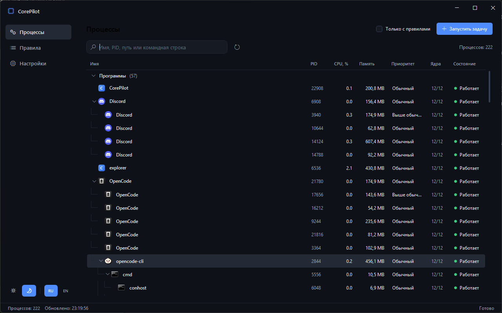
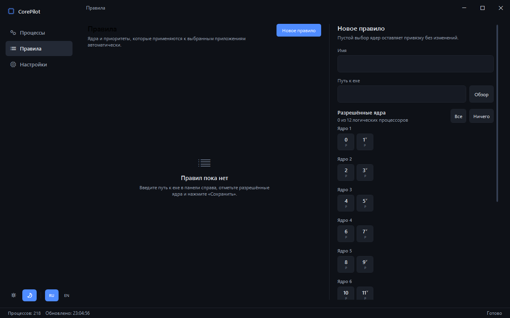
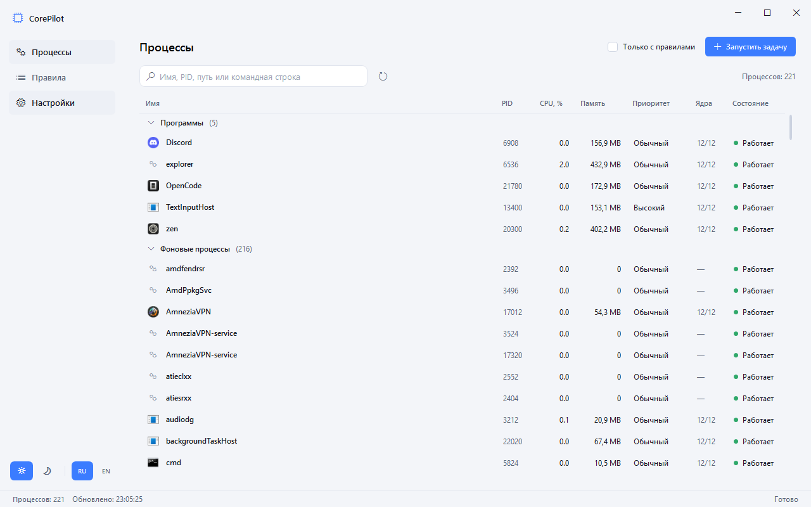

# CorePilot

**CorePilot** — менеджер процессов и привязки к ядрам CPU для Windows в духе Process Lasso.
Позволяет выбрать игру или программу, назначить ей конкретные ядра, приоритеты и сохранить это
как правило, которое применяется автоматически при каждом запуске.

Приложение полностью написано ИИ-агентом — см. раздел [Авторство](#авторство).



## Возможности

### Ядра и приоритеты
- Выбор конкретных логических ядер для любого процесса (сетка ядер).
- Различение физических и виртуальных (SMT) ядер: у второго потока ядра стоит метка `v`.
- Быстрые действия «Все» / «Ничего».
- Приоритеты CPU (`Idle` … `RealTime`), I/O и памяти.
- Приостановка, возобновление, завершение, перезапуск процесса, очистка рабочего набора.

### Правила
- Правило привязывается к исполняемому файлу и хранит маску ядер и приоритеты.
- Автоприменение при старте процесса (`ApplyOnStart`).
- Удержание настроек (`KeepEnforced`): периодическая проверка, что маска и CPU-приоритет не сброшены.
- Применение правил к уже запущенным процессам одной кнопкой.

### Процессы как в Диспетчере задач
- Группы «Программы» и «Фоновые процессы», сворачиваемые заголовки.
- Дерево процессов: дочерние процессы вложены под родителем с линиями и отступами.
- Сворачивание веток, сортировка по любой колонке (внутри ветвей).
- Иконки приложений, командная строка с аргументами, владелец, потоки, память, CPU %.
- Контекстное меню: завершить, открыть файл, открыть расположение, приоритет, копировать путь/командную строку.

### Интерфейс
- Современный минималистичный дизайн, плавающая панель деталей процесса.
- Тёмная и светлая темы, акцентный цвет.
- Полная локализация: русский и английский (автоопределение языка системы).
- Сворачивание в трей, автозапуск с Windows, настраиваемый интервал обновления (0.5–5 с).
- Низкое потребление CPU в простое: таймер останавливается, когда окно скрыто.




## Установка

1. Скачайте `CorePilot-Setup-1.0.0.exe` со страницы [Releases](../../releases).
2. Запустите установщик. Права администратора не нужны: приложение ставится в профиль пользователя.
3. Язык установщика выбирается автоматически (русский/английский).

Требования: Windows 10/11 x64. Установщик содержит self-contained .NET 8 — отдельно ставить runtime не нужно.

> Установщик не подписан сертификатом, поэтому SmartScreen может показать предупреждение.
> Нажмите «Подробнее» → «Выполнить в любом случае».

## Сборка из исходников

Требуется .NET SDK 8.0.

```powershell
git clone https://github.com/HaydenKraus/CorePilot.git
cd CorePilot

dotnet build CorePilot.sln -c Release
dotnet test CorePilot.Tests/CorePilot.Tests.csproj -c Release
dotnet run --project CorePilot.App
```

### Установщик

Нужен [Inno Setup 6](https://jrsoftware.org/isinfo.php) (`winget install JRSoftware.InnoSetup`).

```powershell
powershell -ExecutionPolicy Bypass -File installer/build.ps1
```

Скрипт публикует self-contained сборку в `artifacts/publish` и собирает
`artifacts/installer/CorePilot-Setup-1.0.0.exe`.

## Структура решения

```
CorePilot.Core    модели, контракты, Win32-слой (affinity, приоритеты, снимки процессов)
CorePilot.App     WPF-приложение: UI, ViewModels, сервисы правил/настроек/трея
CorePilot.Tests   xUnit-тесты (маски, правила, локализация, персистентность, интеграция)
installer/        скрипт Inno Setup и сборка установщика
```

Данные приложения хранятся в `%APPDATA%\CorePilot`:

- `settings.json` — настройки;
- `rules.json` — правила;
- `*.json.bak` — резервные копии повреждённых файлов.

## Ограничения

- Приложение работает без прав администратора. Защищённые системные процессы
  (например, `csrss.exe`, `services.exe`) недоступны для изменения.
- Windows не принимает пустую маску ядер, поэтому «Ничего» снимает выбор и показывает ошибку.
- В снимке процесса нет текущих I/O- и memory-приоритетов: в интерфейсе они стартуют
  со значений `Normal`/`Medium`, а из правила подхватываются корректно.
- Удержание правил сравнивает только маску ядер и CPU-приоритет.

## Технологии

- .NET 8, WPF, Windows Forms (только `NotifyIcon`), Win32 P/Invoke.
- Без сторонних NuGet-пакетов в приложении.
- xUnit для тестов.

## Авторство

Проект **полностью спроектирован и написан ИИ** — автономным агентом
[OpenCode](https://opencode.ai) (модель DeepSeek V4.1 Flash) под руководством пользователя.
Человек задавал требования, проверял результат и принимал решения; весь код, тесты,
локализация, интерфейс и документация созданы ИИ.

---

## English

**CorePilot** is a Process Lasso-style CPU affinity and process manager for Windows.
Pick a game or app, choose which cores it may use, set CPU/IO/memory priorities, and save
it as a rule that is applied automatically on every launch.

Highlights: per-core affinity with physical/SMT distinction, enforced rules, Task
Manager-style app/background groups and process tree, suspend/resume/restart, command
lines and arguments, context menu actions, dark/light themes, English/Russian UI, tray
support, low idle CPU usage.

Download the installer from [Releases](../../releases). Windows 10/11 x64; self-contained,
no admin rights required.

Build: `dotnet build CorePilot.sln -c Release`, installer: `installer/build.ps1`
(Inno Setup 6).

The project was **fully designed and written by AI** — the OpenCode agent
(DeepSeek V4.1 Flash) — under user guidance.
